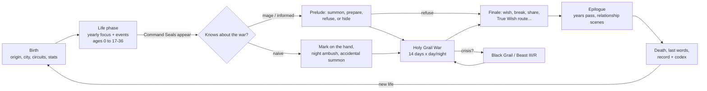

# 01 — Overview

## 1.1 Vision

> "An unofficial fan-made Holy Grail War simulation. Born at random, you live one person's whole life in a city where a Holy
> Grail War breaks out." — the game's own meta description (`index.html` head)

The game is **not** a battle game with a story wrapper. It is a **life** in which a war happens. The Holy Grail War is the
dramatic peak, but childhood, the years that decide what kind of magus (or non-magus) you become, and the decades after the
war carry equal structural weight. The player rarely controls things directly: time flows on its own, and the player answers
prompts, sets a direction, and watches consequences pile up.

## 1.2 Player fantasy

- *"What if I had been born into that world?"* — the randomness of birth is the premise, not an obstacle.
- Being chosen by a Heroic Spirit who fits who you became (summon affinity is computed from your stats and hidden leanings).
- Surviving a war against cleverer, stronger people through preparation, intel, alliances and timing.
- Building a relationship with a legend — trust, friendship, or love — that outlives the war.
- Looking back at a finished life: a written record, a codex entry, a story title ("The Winter of Broken Oaths").

## 1.3 Design pillars (inferred from what the code invests in)

| Pillar | Evidence in the code |
|---|---|
| **A whole life, not a level** | Year loop from birth to ~104 (`index.html:5988`), 238-entry epilogue pool (`EPI_POOL` ~15754), last words on death (`die` 6803) |
| **Who you are decides what you meet** | Leanings bias events (`evW` 2239), servant affinity `exp(fit/8)` (6934), True Wish route gated by leaning ≥ 8 (`kgCan` 11680) |
| **The war runs without you** | NPC planner, 6-axis relations, NPC-vs-NPC fights, ghost teams, `settleRest` when you withdraw (chapter 08) |
| **Fidelity to the source** | 135 servants with per-servant skills, NP matchups (dragon-slayers, demonic targets), 57 rival pair dialogues (`PAIRV` 2522), thousands of voiced lines (`VOICE` 2650, `RLU` 9338) |
| **Every life is a record** | Codex of 135, 219 achievements, past-lives list, shareable war report, global statistics |

## 1.4 Audience

- Fans of the Fate franchise (Korean community first; then EN/JA/ZH).
- Players of text life-sims (BitLife-style) and of auto-battlers/idle sims who enjoy watching systems play out.
- Session-friendly: everything autosaves, there is an auto-play mode, and a life can be paused at any decision.

## 1.5 Platform & session shape

| Item | Value (as implemented) |
|---|---|
| Platform | Browser, PWA installable, mobile-first layout (`manifest.webmanifest`, `sw.js`) |
| Life-phase pace | 16 s per in-game year at 1× (`LEN[40].spy`, `index.html:5497`; UI fixes `len=40` at 17711) |
| War-phase pace | 110 s of progress per war day at 1×; queued beats every `spd/12` ≈ 9.2 s (`gap()` 7917) |
| Speeds | 1×, 2×, 4×, 8×; auto-play picks after `max(500, 1800/speed)` ms (19844) |
| Typical pre-war length | War age 17–36 → roughly 4.5–10 min at 1× before choices (derived: 17–36 years × 16 s) |
| War length | 14 days max; ~26 min of clock at 1× plus decisions (derived: 14 × 110 s) |

## 1.6 Three-act structure

## 1.7 Core loops

| Loop | Cadence | Player verb | Feedback |
|---|---|---|---|
| **Year loop** (life) | every 16 s | Set focus (Training/Study/People/Body/Mind/Work/Balance); answer ≤ 1 event per year | Stat deltas shown as chips, check ✓/✗ lines, art/eye awakenings |
| **Day/night loop** (war) | 2 decisions per war day | Pick a day action and a night action | Intel reveals, battles, trust changes, NPC news |
| **Battle loop** | 5–7 rounds per fight | Pick attack type, NP, master action, seal, retreat | HP/SM bars, round narration, clash FX |
| **Epilogue loop** | years jump | Answer pooled life/relationship scenes | Stat changes, relationship milestones |
| **Meta loop** | per life | Start a new life, optionally bond-summon a past servant, set crisis scenarios | Codex fills, achievements, unlocks (scenarios, Moon Vow) |

## 1.8 Scope at a glance

| Content | Count | Source |
|---|---|---|
| Origins | 7 | `ORIGINS` 4650 |
| Cities | 29 | `CITIES` 5510 |
| Life events / growth events / flavour lines | 127 / 56 / 107 | `EV` 6104, `GROW` 6565, `LINES` 5860 |
| Magecraft lines / Mystic Eye types | 25 / 16 | `ARTS` 12087, `GIFTS` 12389 |
| Servants (classes) | 135 (11 + Beast boss) | `HEROES` 2267 |
| NPC master archetypes | 36 | `ARCHE` 4663 |
| Crossroads dilemmas (war) | 75 | `CROSS` 9440 |
| Epilogue events | 238 + 220 (True Wish) | `EPI_POOL` 15754 |
| Achievements | 219 in client (194 accepted by server) | `ACH` 5390; `src/known.js` |
| Audio files | 145 | `SND_M` 22508 |
