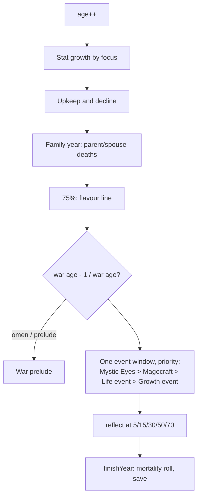

# 02 — Life Simulation

The life phase runs from birth until the Command Seals appear (age 17–36), and resumes after the war as the epilogue
(chapter 10). This chapter covers birth, the yearly loop, events, checks and death.

## 2.1 Time model

| Rule | Value | Source |
|---|---|---|
| Length setting | `LEN={20:{spy:8,spd:55},40:{spy:16,spd:110},60:{spy:24,spd:165}}`; UI always uses 40 | `index.html:5497`, 17711 |
| Seconds per year (`spy`) | 16 s at 1× | 5497 |
| Frame cap | `dt` ≤ 0.25 s per frame | 19019 |
| Clock | `S.clock += dt × speed`; one year passes when `clock ≥ spy` | `tick` 5835 |
| Pauses | Nothing advances while dead, a choice is open (`pending`), paused, or an FX `HOLD` is active | 5833–5840 |
| Speeds | 1× / 2× / 4× / 8× (keys 1–4); Space pauses | 2154, 19074 |
| Auto-play (A) | Picks a random `auto`-flagged option after `max(500, 1800/speed)` ms; `manual` dialogs (seals, catalyst, summon) stop auto | `autoChoice` 5813, `scheduleAuto` 19844 |

> The 20/60 lengths are dead options in the UI, but `spd` is live: it sets war pacing (`gap()` 7917).

## 2.2 Birth (`newLife`, 5552)

Seeded `mulberry32` RNG; birthday/season use a second stream; magecraft and gift rolls use a hash of seed+age+key so they do
not perturb the main sequence (`hrand` 12301). Sex is 50/50 unless chosen in the lobby (18668).

### Origins (`ORIGINS`, 4650)

| id | Origin | Weight | Circuit (1=E…5=A) | Wealth | Flags |
|---|---|---|---|---|---|
| noble | Eldest child of a prestigious magus family | 10 % | 3–5 | 60–85 | mage, heir |
| noble2 | Second child of a prestigious magus family | 10 % | 3–5 | 55–80 | mage, always has a sibling |
| fallen | A fallen magus family | 18 % | 2–4 | 15–40 | mage, heir |
| church | A Holy Church priest's household | 8 % | 2–3 | 35–55 | mage, church |
| exorcist | Exorcist house | 6 % | 1–3 | 30–55 | exorcist |
| common | An ordinary household | 34 % | 1–3 | 25–65 | — |
| orphan | The riverside orphanage | 14 % | 1–4 | 5–20 | orphan, no parents |

### Starting stats (5572)

| Stat | Start | Cap |
|---|---|---|
| Mana | circuit × 7 + 0–8 | `40 + 12 × circuit` (52/64/76/88/100) (5710) |
| Knowledge | 0–4 | 100 |
| Spirit | 15–35 | 100 |
| Bonds | 40–60 (orphan 15–30) | 100 |
| Health | 70–92 | 100 |
| Wealth | origin range | 100 |

**Family:** father 25–40 and mother 23–38 at your birth (none for orphans); sibling always for `noble2`, else 55 % for
non-orphans. **City:** 29 cities in 8 naming pools (ko, ja, en, fr, it, de, cs, tr, zh name sets); uniform weighting
(`CITY_W` is empty, 5517). **Era:** always "present" (birth year 1975–2005) unless set in Custom mode (past 1930–1965,
future 2030–2060) (5563). **War age:** `ri(17,36)`, war year = birth year + war age (5576).

## 2.3 The yearly loop (`advanceYear`, 5988)



### Focus growth (per year, age ≥ 6)

`g = ri(2,5)`; `youth` = 1.2 (≤25), 1.0 (≤45), 0.75 (≤65), 0.5 after.

| Focus | Gains | Notes |
|---|---|---|
| Training | Mana `round(g × youth × (0.6 + 0.15 × circuit) × selfT)`; Health −0–1, Bonds −0–1; art XP | mages/awakened only; `selfT` 0.7 without teacher |
| Study | Knowledge `round(g × youth)` | |
| People | Bonds +g, Spirit +0–1 | |
| Body | Health +2–4; martial art XP | |
| Mind | Spirit +g | |
| Work (16+) | Wealth +g | |
| Balance | small gains in everything (Mana only for mages); 50 % Wealth +0–2 at 16+ | default |

Under 6: Mana +0–2, Knowledge +1–3, Spirit +0–2, Health +0–2. Under 18: extra Knowledge +0–2. Focus is set once at age 6
through a choice (`focusPick` 6762) and can be changed any time after.

### Upkeep and decline

| From | Effect |
|---|---|
| Age 40 | Health −0–2 per year (`ageWear` 6042; −0–1 with `keepFit`) |
| Age 55, Mana > 30 | Mana −0–2 per year |
| Age 18, not Working | Wealth −0–1 per year |
| `sealScar` flag | 12 % per year, Health −1–2 |

### Family year (`famYear`, 6057)

Each parent dies with `min(.5, baseQ(age) × 1.1)`: Bonds −5, Spirit −2, Vengeance +1, possible crest event. Spouse dies with
`baseQ`: Bonds −10, Spirit −4, Health −3.

**Magic Crest** (`crestEvent` 6096): fires when a mage-origin parent dies and you (≥10, heir) inherit. Accept → Mana +20,
Health −10, Spirit +3, +1 art XP per training year, and it substitutes for circuit ≥ B at the Secret Art gate. Refuse →
Spirit +5, Bonds −4, crest passes to the sibling.

## 2.4 Leanings (hidden morality, `AFFN` 5714)

Five hidden counters shape events, summons and the True Wish route.

| Key | Leaning | Typical sources |
|---|---|---|
| avenger | Vengeance | parent deaths, betrayal, orphan start (1) |
| judge | Justice | moral dilemmas, church start (1) |
| cruel | Cruelty | dark growth events (`d_*`), compulsion eyes, curses |
| taboo | Taboo | `t_*` events |
| zeal | Obsession with the Root | `z_*` events, pushing circuits |

`lean(k,n)` shows a chip and a flavour line at 4 and 8 (5720). The dominant leaning increases the weight of events that push it
further (`evW` 2239):

| Leaning value | 0 | 1–2 | 3–5 | 6+ |
|---|---|---|---|---|
| Event weight × | 1 | 1.4 | 1.9 | 2.4 |

This is a deliberate **positive feedback loop**: a life drifts toward a character.

## 2.5 Events

| Pool | Count | Age / chance | Selection | Source |
|---|---|---|---|---|
| Life events (`EV`) | 127, once per life (except `rep`) | 25 % per year under 6, 50 % to war age | weight `w × evW`; `force` events always fire | `rollEvent` 6784 |
| Growth events (`GROW`) | 56 | ages 3–15, 80 % per year if no eye/art event | weighted | `growthEvent` 6769 |
| Flavour lines (`LINES`) | 107 | 75 % per year | focus-matching ×1.5, one-time ×3, 6-year repeat gap, max 3 uses | `annualLine` 5975 |
| Reflection (`QUESTIONS`) | 5 prompts | ages 5, 15, 30, 50, 70 | free text saved to notes | `reflect` 6079 |

**Life event groups:** first brush with magic (`mc_*`, 10), teens (`mt_*`, 10), adults (`ma_*`, 10), self-taught magus
(`mw_*`, 10 — `mw_wall` finds a teacher), core life (42: awakening, rival, first love, Clock Tower exam, study abroad, career,
marriage, children, betrayal, injustice…), relics (15), and moral dilemmas (`l2_*`, 35, the main source of Justice/Vengeance).

**Example dilemma — `l2_01`:** your boss asks you to relabel expired food. Report it (Spirit +3, Wealth −3, Justice +2), quit
(Justice +1), or comply (Wealth +3, Justice −1).

**Relics:** 14 ways to find a catalyst plus a forced auction at war age −1 (Wealth −25, or a theft check
`Mana + Spirit + 0–40 > 90`). Max 3 held (`relicRoom` 6534); a relic names a specific servant (`offerRelic` 6536).

**Orphan path:** 14 phrase substitutions turn "parents" into "teachers" (`ORPH_FIX` 6540), parent-lines are filtered, and
orphan-only events exist; gift odds ×2 and Vengeance starts at 1.

## 2.6 Checks (`chk`, 5764)

| Function | Rule |
|---|---|
| `chk(label, value, need)` | succeeds if `value > need`; typical form `stat + ri(0,N) > threshold` |
| `chkp(label, p)` | plain probability, e.g. first love `0.5 + Bonds/250` |
| Family voice | during the war, an unspent token converts one failed Spirit check into a success (5765) |

Each choice's code is scanned to show which stats it uses (`chkOf`, 5749), and stats are snapshotted before/after to print the
"Mana +3 · Bonds −2" line and ✓/✗ check results (`tracked` 5784). This gives the player **readable cause and effect** without
showing formulas.

## 2.7 Mortality (`mortality`, 6044)

```
baseQ(age) = 0.4% (<1) | 0.12% (<5) | 0.03% (<15) | 0.035% × e^(0.088 × (age − 25))
q = min(0.6, baseQ × e^((50 − Health)/16) + 0.15% if Training and age > 12)
```

| Age | 25 | 50 | 70 | 80 | 90 | 100 |
|---|---|---|---|---|---|---|
| Death chance / year at Health 50 | 0.035 % | ~0.32 % | 1.8 % | 4.4 % | 10.7 % | 25.7 % |

Health 18 multiplies risk ≈ ×7.4; Health 82 ≈ ×0.14. Death is certain at Health ≤ 0 or age 104. Cause of death is chosen by
age and context (`causeFor` 6048): fever under 6, 40 % magecraft accident when training with Mana > 50, seal-scar 15 %,
accidents < 35, illness < 60, old age after.

## 2.8 The war trigger

- **Omen** at war age −1: warm water in the city's tunnels, cats disappearing.
- **Seal shape:** 12 three-stroke designs (bird, sword, flame, moon & star, thorns, rings, lightning, key, eye, horned beast,
  stigmata, waves); church origin gets Stigmata 40 % (`SEALS` 6837).
- **Informed vs naive:** `knowsWar()` (6852) is true for mage origins or the flags `knowsCup` / `watcherCard` / `archive`.

| Prelude | Options |
|---|---|
| Informed (`warPrelude` 6855) | Summon; 3-day family ritual (noble/crest, Wealth −6, Bounded Field +15, Trust +5); buy catalyst on debt (fallen, Wealth −20); tell church father (intel on one pair); ask Clock Tower mentor (same); hand seals to the Church (refuse → epilogue); hide and watch (12 % death, else Spirit +2, Knowledge +3) |
| Naive (`warPreludeNaive` 6869 → `warNaive2` 6879) | Dermatologist / web search / long sleeves / push mana into the mark → night ambush: shout (accidental summon), run to church (Health check `0.6 + Health/400`, fail −20), fight back (Health −12, then accidental summon) |

Accidental summon: Trust +8, servant mana −30, Bounded Field −5 (`accidentalSummon` 6892). Summoning rules continue in
chapter 05.

## 2.9 Relationships outside the war

There is **no dedicated NPC-friend system**. Social life is the Bonds stat, family records (`S.fam`), and flags
(`firstLove`, `friendKnows`, `pet`, `betrayed`, `rebel`).

| Event | Rule |
|---|---|
| `marry` (24–42) | Opposite-sex generated spouse ±3 years; Bonds +10, Wealth +3 |
| `tell_spouse` | 70 % Bonds +8, else −8 |
| `child` (26–44, every 3 years, max 3) | Bonds +6, Wealth −4; child circuit 1–min(5, yours + 1) for mages |

The deep relationship system is reserved for your servant (chapter 07).

## 2.10 Custom Master (point-buy, 5608–5708; UI 18687–18804)

| Rule | Value |
|---|---|
| Budget | `CUST_BUDGET = 10` points (`pt` mode); `free` mode ignores budget but keeps structural limits |
| Circuit above origin max | 3 pt per grade |
| Stat outside its free band | `ceil(distance/5)` pt — charged both above **and** below the band |
| Art level 0–4 | `[0, 2, 4, 7, 11]` pt; first family art −2 pt |
| Chosen Mystic Eye grade 0–5 | `[0, 2, 4, 6, 9, 10]` pt; guaranteed to awaken at 18 |
| Blocking errors | Mana above circuit cap; Master art needs circuit ≥ C; Secret Art must be family line and needs circuit A; ≤ 3 magic lines; ≤ 2 martial/church lines; over budget |
| Extras | Choose city and era; saved to `cupnight.custom.v1`; log line "Born as a Custom Master" |

Known quirks: dumping a stat below its band costs points instead of refunding; lowering circuit is free; the Secret Art rule is
stricter than natural play (A vs B-or-crest); requirements in `ART_CHAIN.req` are skipped (anyone can start with exorcism).
See chapter 14.
