# 03 — Magecraft & Mystic Eyes

Magecraft ("arts") and Mystic Eyes ("gifts") are the master's own power. They are earned in the life phase and spent in war
battles through **Od**, the master's per-battle mana pool.

## 3.1 Magecraft lines (`ARTS` index.html:12087, `ART_CHAIN` 12189, `ART_INFO` 12326)

Tiers: 1 Novice, 2 Adept, 3 Master, 4 Secret Art (`ART_TIER` 12086). "Ability" is the stat gating advancement; "Gain" is the
stat bonus when a level is learned (`ART_UP` 12294).

| Branch | Line | Max | Ability | Gain | Combat role |
|---|---|---|---|---|---|
| Magic | Elemental | 4 | Mana | Mana +2 | Reinforcement buff; magic attack in duels |
| | Bounded Field | 4 | Spirit | Spirit +2 | Cover barrier −25/35/45 % damage; break enemy fields |
| | Healing | 3 | Knowledge | Knowledge +2 | First aid +12/18; twice per battle at Master (needs Knowledge 30) |
| | Curses | 4 | Spirit | Spirit +1 | Hex debuff; Master gives Cruelty +1 |
| | Reinforcement | 3 | Health | Health +1 | Buff; strengthens martial duels |
| | Mental Interference | 3 | Spirit | Spirit +1 | Hex; erase witnesses → lower Exposure |
| | Jewel | 3 | Mana | Mana +1 | Buff; throw jewel for Wealth −5 |
| | Rune | 3 | Knowledge | Knowledge +1 | Ward and heal |
| | Alchemy | 3 | Knowledge | Knowledge +1, Wealth +2 | Heal; homunculus familiar at Master |
| | Familiar | 3 | Bonds | Bonds +1 | Scouting, night watch; detection halved at Master |
| | Necromancy | 3 | Spirit | Spirit +1 | Intel on entering battle; ghost guards at Adept |
| | Puppetry | 3 | Knowledge | Knowledge +1 | Ward; decoy doll once per war |
| | Astrology | 3 | Knowledge | Knowledge +1 | Read duel intent; foresee ambush |
| | Projection *(new)* | 3 | Mana | Mana +1, Knowledge +1 | Weapon Projection: power +5 + 3 × level |
| | Spiritual Evocation *(new)* | 3 | Spirit | Spirit +2 | Spirit Possession 2 rounds; +8 servant mana at Master |
| | Illusion *(new)* | 3 | Knowledge | Knowledge +1, Spirit +1 | Mirage decoy: dodge +10–32 %; less Exposure |
| | Displacement *(new)* | 3 | Knowledge | Knowledge +2 | Swap counter: damage −14–42 % |
| Church | Baptism Rite | 3 | Spirit | Spirit +2 | Enemy power −4/6/8; doubled vs Avengers, Shadows, Apostles |
| | Black Keys | 2 | Health | Health +1 | Throw at the enemy master |
| | Executor's arts | 2 | Health | Health +2 | Martial; bonus vs Apostles and spirits |
| Martial | Bajiquan | 3 | Health | Health +2 | Bajiquan strike |
| | Hidden Hand | 3 | Spirit | Spirit +1 | Aim for the vitals |
| | Swordsmanship | 3 | Spirit | Spirit +2 | Draw the blade |
| | Firearms & CQC | 3 | Health | Health +1 | Gun usable twice; better vs magi |
| | Demon-hunting | 2 | Health | Health +2 | Exorcist origin only |

*New* = added in the post-2.02 commit "four new magic learned arts" (`arts41125`, 12091).

### Family arts (`FAMILY_ART` 12097)

| Origin | Candidate family lines (one picked by hash, starts at Novice, marked "main line") |
|---|---|
| noble / noble2 | Elemental, Jewel, Rune, Bounded Field, Necromancy, Puppetry, Astrology |
| fallen | Elemental, Curses, Alchemy, Familiar |
| church | Baptism Rite |
| exorcist | Demon-hunting |

**Awakening** for non-mage origins (`awaken` 6086): unlocks Training focus and grants Novice in Elemental, Bounded Field,
Healing or Curses (weighted by leanings ≥ 3), as a self-founded main line. Without a teacher training is 70 % efficient.

## 3.2 Advancement (`artCand`/`artEvent`, 12302–12323)

```
P(advance to next level) = ART_P[level] × main(×3) × origin mult (ART_ORG) × leaning mult (ART_AFF, squared at ≥ 6)
                           × 0.3 if previously declined × 3 if XP ≥ ART_NEED
ART_P   = [0, .20, .08, .03, .01]
ART_NEED= {2: 8, 3: 20, 4: 40} XP
```

| Target level | Gate |
|---|---|
| 1 (magic) | mage/awakened, < 3 magic lines, age 6–30 |
| 1 (martial) | < 2 body lines, age 8–35, ×0.12 with Body focus else ×0.03 |
| 2 | ≥ 2 years since last level, age ≤ 50, ability ≥ 40 |
| 3 | ≥ 3 years since last level, ability ≥ 60, magic needs circuit ≥ C (3) |
| 4 | age ≥ 25, main line only, circuit ≥ B (4) **or** crest |

**Pity:** 2+ years sitting at a level with enough XP → guaranteed advance. **XP:** Training gives main line +3 (×1.4 with a
teacher, +1 with crest) and one sub-line +1; Body focus gives a martial line +2.

**Event choice when an art advances:** "Dig deep" (quality 1.2, Health −3, Bonds −2) / "Learn just enough" (quality 1) /
"Not now" (no art events for 3 years; that line ×0.3).

**Combat scaling** (`artMul` 12380): Novice ×1, Adept ×1.5, Master+ ×2, × quality.

## 3.3 Mystic Eyes (`GIFTS` 12389)

Grades (`GRADE_N`): 1 Low, 2 Mid, 3 High, 4 Jewel, 5 Rainbow.

### Birth roll (`giftRoll` 12439)

`P = 3 % × origin mult` (orphan ×2, exorcist ×4, mage origins ×1.5) → common 3 %, noble 4.5 %, orphan 6 %, exorcist 12 %.
Type weighted by `w` below (sum 144.2 for non-exorcists); grade uniform within range.

| Eye | w | Grades | Duel bonus | Battle action (`EYE_D` 12477, `MACT.eye` 12562) |
|---|---|---|---|---|
| Charm | 25 | 1–3 | +4 disrupt/trick | Enemy master hesitates: −(5 + 1.5F) |
| Binding | 20 | 1–3 | +3 all | Bind master −(6 + 1.5F); winning a duel downs the master |
| Ignition | 14 | 2–3 | +5 attack/rush | −(8 + 2F) |
| Petrification | 6 | 3–4 | — | 3 rounds of −(14 + 3F), reduced by Magic Resistance; once |
| Future Sight | 10 | 2–4 | +2 all | 3 rounds of damage −(25 + 4F) %, max 50 %; once |
| Retrocognition | 10 | 2–3 | — | Passive intel at battle start |
| Jinx | 6 | 3 | +4 attack/rush | Jinx marks −5 each, up to 3 |
| Compulsion | 1.5 | 4 | +5 disrupt/trick | Control master 3 rounds; Spirit −2, Cruelty +1 (hidden achievement) |
| Telekinesis | 8 | 1–3 | +3 defend/hide | Damage −(20 + 3F) % |
| Demon blood | 0 (40 exorcist) | 2–3 | +8 rush/hide/trick | Passive |
| Illusion *(new)* | 12 | 1–3 | +4 defend/hide | 2-round false target |
| Clairvoyance *(new)* | 10 | 2–3 | +3 attack/disrupt | Power +(4 + 1.5F), intel; reveals skills at High |
| Immobilization *(new)* | 12 | 1–3 | +4 rush, +3 attack | Agility/escape penalty; next hit +6 + 2F |
| Vision Theft *(new)* | 8 | 2–3 | +4 disrupt/trick | Steal intel, reveal skills, lower Exposure, Knowledge +1 (≤ 3/battle) |
| Prolongation *(new)* | 1.5 | 4 | +3 all | Extend active buffs 1–2 rounds at ×1.25–1.35 |
| Death Perception *(new)* | 0.2 | 4–5 | +5 attack/rush | Grasp 15–92 %; "line" or "point" (instant kill); needs Spirit ≥ 35 and direct sight; Rainbow 12 % of the time |

`F` = strength factor `GIFT_F = [0, 1, 2.5, 4, 6, 8.5]` by grade × `[.7, 1, 1.3]` by control (12446).

**Health cost per use** (12449): base `[4, 2, 0]` by control; Compulsion +8; Prolongation +4; Death Perception
12 + [6, 3, 1] + 6 per earlier use in the same battle — the strongest eye is self-limiting.

### Eye lifecycle (`giftEvent` 12459)

```mermaid
stateDiagram-v2
  [*] --> Latent: birth roll succeeds
  Latent --> Awakened: age 6-18, 15%/yr (x3 in a year a parent died); Custom: guaranteed at 18
  Awakened --> Control1: <=50, 15%/yr, choose a teacher
  Control1 --> Control2: same
  Control2 --> GradeUp: 30%/yr (Death Perception 15%) up to type max
```



Ways to gain control: the Church (Wealth −5), family way (exorcist, Spirit +2), a teacher, alone (50 %, else Health −5), or
keep the eyes closed (decline).

## 3.4 Od and master battle actions (`MACT` 12549, `MACT_UI` 12650)

**Od per battle:** `circuit × 12 + Mana × 0.4` (`oddMax` 12519).

| Action | Od cost | Requirement |
|---|---|---|
| Buff (reinforce servant) | 25 | Elemental/Reinforcement/Jewel |
| Hex (debuff enemy) | 25 | Curses/Mental/Familiar |
| Ward (barrier) | 20 | Bounded Field/Rune/Puppetry |
| Heal | 30 | Healing/Rune/Alchemy |
| Baptism | 25 | Baptism Rite |
| Projection | 20 | Projection |
| Evoke | 25 | Evocation |
| Mirage | 20 | Illusion |
| Swap | 25 | Displacement |
| Eye | free (Health cost) | any awakened eye |
| Gem / Decoy | free (Wealth / once per war) | Jewel / Puppetry |
| Body actions: gap, back, key | Health `[10, 8, 6, 4, 2]` by martial level | martial / Black Keys |
| Non-mage: cheer, lure, cover | free | Trust ≥ 50 / — / Knowledge ≥ 30 |

These sit beside the servant's own attack choice each round (chapter 06), so a strong master shifts fights without directly
fighting servants. Master-vs-master duels (`MD`) use a rock-paper-scissors core: attack > trick > defend > attack.
