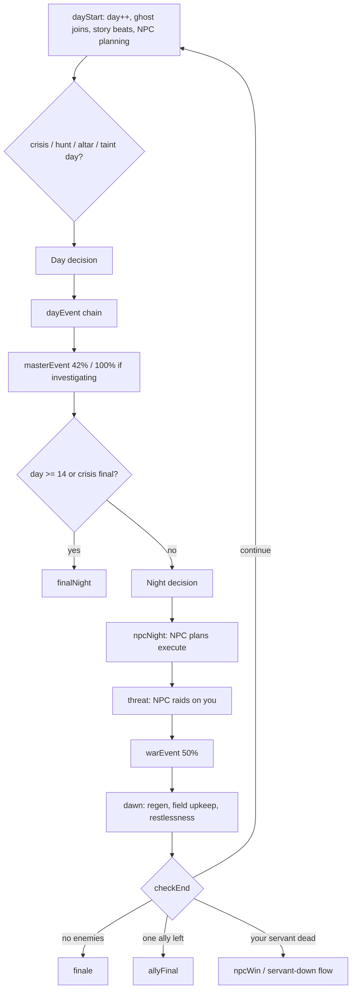

# 05 — The Holy Grail War

The war is a 14-day autonomous simulation. The player makes **one day decision and one night decision per day**; everything
else (NPC plans, NPC-vs-NPC fights, raids on you, events) is resolved by the engine and narrated in the log.

## 5.1 Summoning (`summonStep`/`doSummon`, index.html:6908–7030)

**Catalyst choice:** an owned relic, a **bond summon** of a past-life servant (chapter 11), or nothing.

**Resolution order:**

1. Full moon check: 1 in 8.
2. Special-class chance `pSp = min(.6, .015 + .06 × max(Vengeance, Justice))`.
3. Bond summon roll (`S.bond.p`; 100 % if you won the Grail with that servant).
4. Relic + Vengeance/Justice ≥ 5: chance `pSp × 0.5` the relic is hijacked by an Avenger or Ruler.
5. Otherwise the relic's servant.
6. No relic on a full moon: 2.5 % (5 % with Moon Vow) BB hijacks the circle (chapter 09).
7. Otherwise roll `pSp` for an Avenger/Ruler.
8. Otherwise weighted pick among normal classes: `affinity(h) × sumW(h)`.

**Affinity — "the Grail picks someone like you":**

```
traitScore: Honor = Spirit; Compassion = Bonds; Loyalty = (Bonds + Spirit)/2; Ambition = Mana;
            Freedom = min(100, (Spirit + 100 − Bonds)/2 + 20 [+15 rebel, +10 orphan])
matchOf   = mean of the servant's trait scores (single trait padded with 50)
fitScore  = match + leaning adjustments (Cruelty ≥ 4: Compassion −15, Honor −10, Ambition +5; Taboo ≥ 4; Root ≥ 4;
            Justice ≥ 3: Honor +5, Compassion +5; Vengeance ≥ 3: Freedom +5, Ambition +5, Compassion −5)
affinity  = exp(fitScore / 8)          → +10 fit ≈ ×3.5 likelihood
sumW      = ×2 if never contracted before (×3 "pickup" window ended 2026-11-06)
```

## 5.2 Forming the field (6984–7013)

- The seven normal classes minus yours become NPC pairs, each with a random unused servant of that class.
- 12 % chance of an **8th seat** (special class). If your servant is a special class there are always 8 pairs.
- NPC masters are drawn from 36 archetypes (`ARCHE` 4663; e.g. Student pw 22–40, Burial nun 72–92, Heir 74–90). Exorcists
  only appear in Korean/Japanese/Chinese cities; the Burial Agency nun is gated at 25 %; your sibling can take a seat (35 %)
  if the inheritance dispute is live.
- **Ghost seat** (15 %, `ghostSeat` 6949): a team sent by another player joins on day 5–7 (chapter 11).

**Initial state (7006):**

| Field | Start |
|---|---|
| Servant HP / SM (servant mana) | 100 / 100 |
| Trust | `20 + match × 0.4`, −5 if fit < 50 (+8 accidental summon, +5 ritual) |
| Exposure | 0 (10 if you ignored the Mage Association) |
| Bounded Field (fort) | 25 noble / 10 others, +3 × Territory Creation rank (+15 ritual) |
| Command Seals | 3 |
| Crisis | 20 % (25 % if any Avenger) — see chapter 09 |

**First meeting** (`firstMeeting` 7031): bow formally (+3 + trait reaction), ask their wish, "show who's master", discuss
strategy (Knowledge ≥ 25: fort +6, +15 intel on one pair); mute servants allow pushing mana into them.

## 5.3 The day/night loop



### Day decisions (`dayDecision` 9783)

| Choice | Effect |
|---|---|
| Routine (school/work…) | Exposure −6, Spirit +1 |
| Investigate the streets | Intel `10–20 + Knowledge × 0.06` on the least-known pair; master event forced |
| Walk the city with the servant | Trust up, Exposure +3 (chapter 07) |
| Recover | Servant HP `+5 + Mana × 0.1` (+heal/alchemy), SM +5, Health +4 |
| Mend the Bounded Field | fort `+8–14` (+8 Caster, +Mana × 0.05); disabled on altar day |
| Visit the Church | 12 weighted scenes (`CHURCH_SC`): location tips, Grail purity, eliminated identities, paid intel (Wealth −8 for +40), healing, confession, Apostle-kill quest (+1 seal), warnings |
| Familiar / rite / crisis actions | conditional |

**Day event priority** (`dayEvent` 10200): hostage → relationship try → relationship day → coalition → siege → crossroads
(65 %, ≤ 5 per war, from day 2) → 60 % chance of a `DAY_EV` (~30 entries: mana shortages, gems, leylines, blood-sharing,
family calls…). **Master events** (`MASTER_EV` 10288): one sequential story arc per archetype, covering 26 of 36 archetypes.

### Night decisions (`nightDecision` 10473)

| Choice | Condition / effect |
|---|---|
| Settle a promised duel | forced if pending |
| Scout | intel `20–35` (+12 Archer, +15 `intel`, +25 `judge`) + insight + Knowledge × 0.08; ambush on return 16 % (+10 % vs hunters) |
| Raid | SM ≥ 20; starts a battle |
| Unravel an enemy field | mage vs Caster |
| Blow up a lair | Wealth 15; success `clamp(.1, .8, .3 + Spirit×.003 + intel×.003 − pw×.003 − .15 Instinct)`, 10 % kills the master |
| Defend the lair | fort `+6–12` (+10 Caster, + Territory Creation), HP +3 |
| Talk with the servant | Trust up |
| Propose an alliance | chapter 08 |
| Lie low | HP `+6 + Mana × 0.05`, SM +6, lower threat |
| Class actions | below |
| Join a hunt / go to the altar / sacrifice civilians (Cruelty ≥ 4) / crisis actions | conditional |

### Dawn (14724)

```
HP  += 2 + Mana × .06 + min(fort, 50) × .03 + regen + heal × .6 + 2 × workshop
SM  += 6 + Mana × .1 + regen + 4 leyline + 3 altar + 3 rite − 3 mud − 4 dry + 2 × workshop
fort decays 7%/day (halved for Casters/Territory Creation); upkeep SM (fort − 40)/4 (+4 workshop);
fort ≥ 40 raises Exposure by (fort − 40)/10 + 1
```

**Restlessness:** Honor/Ambition servants lose trust after 3+ days without fighting (−2 Honor, −3 Ambition, +1 at 5+ days,
cap 5). This pushes against pure turtling.

## 5.4 Class night actions

| Class | Action | Rule |
|---|---|---|
| Archer | Snipe (10530) | `my = AGI×3 + LUCK×2 + insight×1.2 + SNIPE×4`; vs servant `d = my − (oAGI×3 + evade×1.5 + insight + 14)` → 5–25 dmg (×1.5 great), SM −10; vs master great → kill, ok → hurt; bad → Exposure +12 / counter-shot / you get raided |
| Caster | Workshop (10575) | progress `18 + MANA×3 + (fort+regen)×2 + Knowledge×.15`/night, Wealth −4; at 100: fort +15, defense +12 |
| Caster | Gather mana (10584) | small: `15 + MANA×3 + power×.8`, heat +1, Exposure +5; large: +40…, heat +3, Exposure +15, civilian incident; heat ≥ 3 Church warning, ≥ 6 hunted |
| Assassin | Infiltrate (10599–10676) | `infilD = AGI×2 + stealth×1.5 + LUCK×1.5 + intel×.12 + 8 − defences`; great (≥ 26): 65 % master badly hurt else killed; ok: true name + skills |
| Rider | Rider scouting | intel +40–55, Exposure +12, SM −8, 15 % second target |
| Ruler | Commands (10679) | `rulerD = (MANA×3 + LUCK×2 + 10) − (oMANA×3 + oMR×2 + 4)`; Halt (2 nights), Summon (forced duel), Expel (HP ≤ 50 targets: −25/−40, no regen 3 days); Revelation; Mediate (`Bonds×.3 + trust×.2 + LUCK×2 + U(0,20) ≥ 30` → one-night truce) |
| Moon Cancer | Rewrite records (10750) | every 3 days: Exposure −20, +25 intel on one pair |
| Avenger | Mark | +8 power vs the marked target |
| Alter Ego | Absorb | +15 HP and +15 SM per kill |

Shared resolver `contest(d, great=14)`: `r = d + U(−18, 18)` → great (r ≥ threshold) / ok (≥ 0) / fail (> −14) / bad.

## 5.5 Intel (8089–8160)

| Intel on a pair | Unlocks |
|---|---|
| 30 | Lair location |
| 45 | Special-class reveal |
| 50 | Master's wish |
| 60 | Origin hint (e.g. Mahabharata → "Indian epic", `HINT_SRC`) |
| 80 | True name (50 with a `judge` servant) |
| 90 | Two skills |

NPs are never revealed by intel points — only by seeing them, lore checks or allies. Unrevealed enemies show class-average
stats in odds displays (`clsGuess`). Your own **Exposure** feeds enemy power (+Exposure × .12) and at ≥ 70 they know your NP.

## 5.6 Being hunted (`threat`, 14547)

```
P(raid on you) = max(.03, .13 + Exposure×.003 + day×.011 − .12 hid − min(fort,50)×.0015 + .08 no seals
                 − stealth×.012 − illusion×.03 + .12 provoked + .08 hunted + .06 altar prep)
```

Fort ≥ 50: attacker turns back with `min(.85, (fort − 40)/60)` (halved for reckless/hunter tactics) or breaks the field.
NPC Assassins visit 50 % of the time; an ally may come to help.

## 5.7 Pressure systems

| System | Trigger | Player responses |
|---|---|---|
| **Siege** (10202) | fort ≥ 50, day ≥ 3, ≤ 3/war, 3-day cooldown; `.25 + (fort − 50) × .01` | thicken field (½ damage), strike first, relocate (fort ×.3, Exposure −15), seal |
| **Coalition** (10215) | day ≥ 8 (≥ 6 if fort ≥ 60) and you avoided fights (strikes < day/3); 70 % | prepare (fort +6), strike first, abandon lair (50 % unfound) |
| **Hostage** (10262) | day ≥ 5, passive streak, Exposure ≥ 40, ruthless enemy; `min(.35, .04 + .07 × (passN − 1))` | rescue battle (enemy +10 rounds 1–2), seal "Bring them back", give up (60 % hostage dies) |
| **Supervisor's hunt** (`HUNT` 9137) | day 4–8, once per war: serial disappearances / tainted servant / city-altar rite | join (raid +12, enemy takes ×.6/.8, last hit +1 seal), ignore (mud/dry/cold supervisor), or betray it |
| **You are the hunt target** | Cruelty sacrifices ≥ 2, taint ≥ 2, or Root rite stage 2 | 2 waves, enemy +12, retreat ×.5 |
| **Grail altar** (9105) | `altarDay` = day 10–12 with ≥ 2 enemies left; defensive choices locked | fight the claimant; winner gets +6 final power, +3 SM/day; mage servants can foresee and pre-claim (`min(.8, .3 + Knowledge×.003 + fort×.02 + clairvoyance×.02)`) |

These systems exist to break degenerate strategies: turtling (siege, coalition, hostage, restlessness), over-aggression
(Exposure, hunts), and cruelty (becoming the hunt target).

## 5.8 Strays, withdrawal and the end

- **Stray servants** (`strayFightNight` 7565) survive 1 + MANA bonus + Independent Action days (cap 7), hunting their master's
  killer (75 %) or random targets.
- **Withdraw:** `settleRest` silently simulates the rest of the war to pick a winner.
- **Final night** (`finalNight` 14764, day 14): NPC pairs fight pairwise until one remains; you fight the last enemy with no
  fleeing.
- **checkEnd** (14787): no enemies → `finale`; only one ally left → `allyFinal`; your servant dead → `npcWin` or the
  servant-down flow (chapter 06). Endings are in chapter 10.
