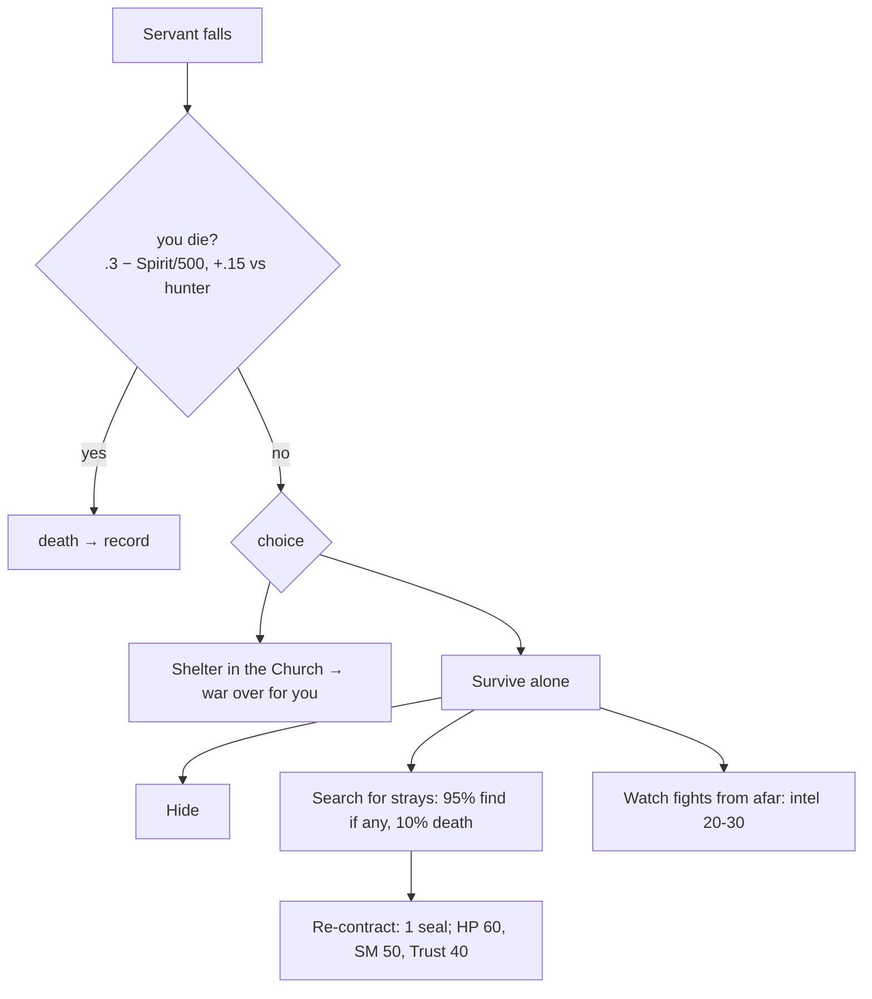

# 06 — Combat

Combat is a **round-based contest of two power numbers with heavy noise**, wrapped in choices (attack type, NP, master action,
Command Seal, retreat). Battles last 5–6 rounds (raids 7, finals unlimited); then "dawn ends it".

## 6.1 Power

### Base (index.html:7971)

```
heroBase(P, hp) = (78 + STR×1.7 + (AGI + END + MANA)×1.4 + LUCK×1.9) × (.55 + .45 × hp/100)
```

A wounded servant fights at as little as 55 % of full power — HP is both health and strength.

### Your side (`myPower`, 7972)

```
P = heroBase + clsBonus − 6 + trust×.15 + masterMana×.12 + enemyIntel×.1
  + (defending ? fort×.2×fortRead(e)×(breach ? .5 : 1) : 0)
  + clsEdge + EDGE + skill terms + avenge + gate (+7, +5 if hp < 50)
  + underdog + mark (+8) + zone/mud + workshop defence (5×wsF)
  − trap (0/4/8) ± Saint's Number (day +rank×4 / night −rank×1.2)
  + judged (+22) + boost + taint×5 − Berserker distrust (6)
```

### NPC side (`npcPower`, 8071)

```
E = heroBase + clsBonus + pw×.32 + skill terms + clsEdge + ambush + underdog
  − 8 (master injured) + plan.fort×.08 (defending) + (vs you) Exposure×.12 + 8 (they marked you)
```

| Bonus | Rule |
|---|---|
| `clsBonus` (8046) | Caster +MANA×1.2; mage-Berserkers (Morgan, Kriemhild) +MANA×2; Assassin +AGI×1 |
| `clsEdge` (8048) | Caster defending lair +12 with workshop / +4 without; Archer +7 in rounds 1–2 |
| Underdog (`MECH` 8055) | linear regression over 9 mechanics features (fitted on 129 heroes, R² 0.73); `underdog = min(15, max(0, 22 − mechScore)/1.5)`; also +10 % damage dealt, −10 % taken, +8 pts flee |

## 6.2 Round resolution (`clash`, 13391)

```
P_round = P + bonuses + master buffs + final/altar/rite (+6 each) + raid (+12) + initiative (r1 +10, r2 +5)
        + madness (+12) + U(−18, 18) − enemy sabotage − mana starvation (SM ≤ 0 → −30, < 15 → −10)
E_round = E − master debuffs + U(−18, 18) + hunt pressure + reckless (+6) + NPC actions + hostage (+10, r ≤ 2) ...
d = P_round − E_round
```

| Result | Rule |
|---|---|
| Draw | `|d| < 8`: both lose 3–7 HP |
| Reversal | when `|d| ≥ 8`, the losing side strikes first with `.07 + LUCK × .08/6` (E ≈ 8 %, EX = 15 %) |
| Dodge | `clamp(.05 + (AGI − oAGI) × .012, .03, .15)`, halved vs magic |
| Hit | `round((6 + d × .3) × atkM) − guard`, × (1 − min(.35, evade × .035)) × Siegfried .82 × Karna .7; winner takes 1–5 |
| Survival | survive skills / Heracles `revive` stand back up; both at 0 → mutual kill |

### Attack types (`atkM`, 8030)

| Type | Multiplier |
|---|---|
| Head-on | `clamp(1 + (STR − oEND)×.08 + (AGI − oAGI)×.02, .6, 1.6)` |
| Magic | `clamp(1 + (MANA − oMANA)×.04 + agi×.5, .7, 1.35) × (1 − min(.4, MR×.04))` |
| Mana burst | `clamp(1 + ((STR + MANA)/2 − oEND)×.04 + agi, .7, 1.35) × (1 + rank×.02)` |

This is the main tactical read: high-STR servants should go head-on into low-END foes; magic is bad into high Magic
Resistance.

## 6.3 Battle action menu (`battleRound`, 12020)

| Action | Effect |
|---|---|
| Head-on / Magic / Mana burst | attack type above |
| Noble Phantasm | see 6.4; costs SM |
| Seal: "Refill mana" | SM +40 |
| Seal: "Win!" | +3 ranks to every stat this round (+2 under Distrust), NP ×1.3 |
| Seal: "Return!" | guaranteed retreat |
| Exploit a weakness | Knowledge ≥ 40: success `.3 (.45 if NP known) + Knowledge/200` → +10 + Knowledge × .2 |
| Berserker madness | +12 for 3 rounds, no fleeing, double SM cost, then HP −10 and Trust −3 |
| Ruler verdict | +22, twice per war |
| Talk to the enemy | relationship/intel |
| Assassinate the master | `reach × (1 − guard) + .10`, max .85 (reach and guard formulas in `asnReach` 10621, `GUARD_T` 10631) |
| Master action | Od-paid magecraft/eyes (chapter 03) |
| Enkidu morph | switch stance |
| Retreat | 6.5 |
| Free "Bond" buff | Trust ≥ 80 and HP < 35: a free "Win!" once per war (12025) |

## 6.4 Noble Phantasm clash (`npClash`, 13235)

When both sides fire NPs in the same round:

```
CV = npRV×8 + MANA×3 + 15 (seal; halved inside Qin's field) + 8 (known) − 6 (HP < 30) + 4 (trust ≥ 80) + npCVsp + U(−10, +10)
D  = CV_me − CV_en + (SCV_me − SCV_en) × 3
|D| ≥ 8 → winner pierces: deals dmg × pf(D) (0.6 → 1.0 over D = 8…24); loser deals 10 % back
|D| < 8 → both scatter: each side deals 30 %
```

A seal "Push through" adds to CV. Clashes trigger a full-screen FX (`clashFx`, chapter 12).

## 6.5 Retreat (`retreat`, 13704)

```
fleeP = escape ? 1 : min(.95, .45 + AGI×.05 + ride×.03 + evade×.02 + .08×underdogFactor)
failed retreat: HP −18…−32
```

Refusals: under Distrust 30 %; prideful servants (pride ≥ 70) refuse with
`(pride − 55)×.012 + grudge×.004 − respect×.005 − .2 (loyal) − .25 (trust ≥ 80)`.

**NPC retreat thresholds** (`WOUND_TAC`/`WOUND_CLS` 14113–14152): `ret` (flee mid-fight), `floor` (no raids below), `wp` (raid
willingness while wounded); e.g. defensive 38/70/.2, reckless 10/25/.85, Berserker −10/−10/×1.3; adjusted by persona. An NPC
under 80 HP raids with `wp + (1 − wp) × (hp − floor)/(80 − floor)`.

## 6.6 When your servant falls (`myHeroDown`, 13935)



## 6.7 Master vs own servant duel (`DUEL_*`, 11034–11240)

Used only by the True Wish route (chapter 09), when your servant opposes your dark wish.

- **Master conversion** (`duelMaster`): martial and magic arts become a 5-stat line; Grail power `gi = circuit × 5 + highArts × 2`.
- **Servant resolve R** (0–100): hesitation chance `min(.3, (85 − R)/100)` → servant −14 power; NP chance gated by R/90.
- **Talk options** lower R: kept promise −10 × mu; memory −8/−12 × mu (mu = 1 / 1.25 / 1.5 / 2 by relationship stage).
- **High-tier arts** (`DUEL_BK`): attack / hex / wall / heal, 20 Od each. Seal "Stop!": servant −20 power (reduced by MR),
  blocks the NP.

## 6.8 Balance character

- Noise `U(−18, 18)` per side gives a ±36 swing against an 8-point decisive threshold: **upsets are frequent by design**.
- The underdog term (≤ 15) compresses the roster further.
- NP damage (~45 for rank A) is large against 100 HP; one NP plus one failed retreat is often decisive.
- Player-side master contribution (`trust×.15 + mana×.12 − 6`, roughly −6…+21, plus Od actions) is structurally different from
  NPC `pw × .32` (≈ 7–29). See chapter 14 for evaluation.
