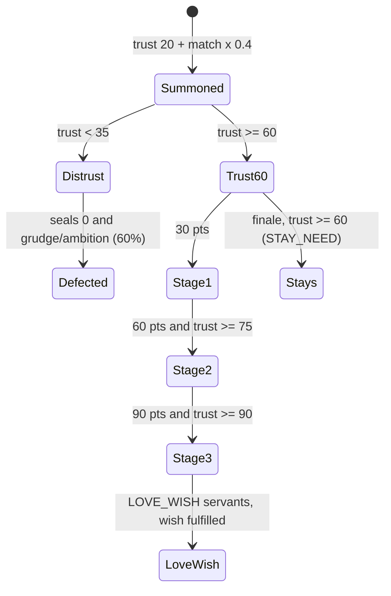

# 07 — Servant Bond

Your relationship with your servant is the emotional spine of the game. It is modelled with three layers: **Trust** (war
mechanics), **Fit** (personality compatibility that scales trust changes), and **Relationship stage** (romance or friendship
that drives dialogue and epilogues).

## 7.1 Trust (index.html:9262–9287)

| Tier | Range | Mechanical meaning |
|---|---|---|
| Distrust | < 35 (`DIST` 2234) | 30 % retreat refusal; positive reactions halved; risk of defection when seals run out |
| Normal | 35–59 | — |
| Trust | 60–79 | NP cost ×.85; relationship points start accruing; servant can be asked to stay after the war |
| Bond | ≥ 80 | +4 NP clash; free "Win!" once at HP < 35; loyal interception more likely |

Trust also feeds power directly: `myPower += trust × .15 − 6` (chapter 06).

**Diminishing gains** (`trustGain` 9269): `n × clamp(1 − (trust − 30)/50, .1, 1)` → full up to 30, half at 55, 0.2× at 70,
0.1× floor from 75. Reaching Bond is slow on purpose.

**Reactions** (`crossReact` 9270): each choice carries reaction tables per trait (Honor, Compassion, Loyalty, Ambition,
Freedom) and per alignment; trait sum ×1.5 (×1.5 more for single-trait servants), averaged with alignment; negatives ×.7 at
trust ≥ 70, positives ×.5 under Distrust; clamped −18…+15. Likes/dislikes (`HLK`: sacrifice, scheming, rescue, head-on
fights, ruthlessness, discipline) add ±3/±6. Alignment (`HAL`) codes: L/N/C × G/B/E/M.

## 7.2 Fit (10840–10862)

`fitScore` = trait match adjusted by your leanings (chapter 05). Tiers: Good ≥ 70, Neutral 50–69, Mismatch < 50.

| Fit | Trust gains | Trust losses |
|---|---|---|
| Good | ×1.2 | ×0.8 |
| Neutral | ×1 | ×1 |
| Mismatch | ×`[.5, .65, .8, 1]` by relationship stage, with `[.25, .15, .05, 0]` chance of −2 instead | ×`[1.2, 1.15, 1.1, 1]` |

Fit is re-checked live when a leaning crosses its threshold during the war (`fitLive`), so becoming crueller mid-war can sour
a Compassion servant.

## 7.3 Daily bonding actions

| Action | Effect |
|---|---|
| Talk (night) | +3–6 (+2 if Bonds > 60, −2 for Avengers) through the fit curve; HP +5; 70 % reveals a backstory fragment; Trust ≥ 70: 35 % learn Grail purity |
| Outing (day) | +2–4, Exposure +3; 50 % fragment at Trust ≥ 50; Freedom servants prefer outings, Honor/Loyalty prefer talks (±1) |
| Crossroads (`CROSS` 9440) | 75 moral dilemmas (14 named + x01–x61), 65 % chance per day from day 2, ≤ 5 per war; per-trait reactions; some options gated by leanings |

## 7.4 Relationship stages (9288–9420)

| Track | Stage 1 | Stage 2 | Stage 3 |
|---|---|---|---|
| Love | Fondness | Yearning | Lovers |
| Friendship | Comrades | Close Friends | Sworn Friends |

| Rule | Value |
|---|---|
| Points needed | `REL_PT = [0, 30, 60, 90]` |
| Trust needed | `REL_REQ = [0, 60, 75, 90]` |
| Gain | only at Trust ≥ 60: `pt += n × .65 × (1 + (trust − 60) × .015)` |
| Sources | first defensive/support action in a battle +3; trust gains outside war +4; all fragments heard +10; war scenes: dream 30 % (+5), wound 50 % at HP < 40 (+6), rooftop 25 % (+4), festival 30 % at stage ≥ 2 (+10, Exposure), jealousy 35 % with a living ally (+6) |
| Distrust | −10 points; stage never goes down |
| Love track allowed if | opposite sex, servant not sexless, not one of 5 child servants (`REL_CHILD`) or 15 no-romance servants (`REL_NOLOVE`), master ≥ 18, no living spouse |
| Stage-up scene | advance / wait (retry in 3 days, or 2 years post-war) / switch to friendship |
| Later switch to love | once, if friendship was forced by age (after 19) or spouse (3+ years after their death), Trust ≥ 75 (`relSwitch` 16651) |

Stages have **no combat effect**. They change dialogue (`RLX`, `RLU` 750 KB of per-servant lines), the finale (`LOVE_WISH`),
duel resolve, and the epilogue (chapter 10).

## 7.5 Command Seals (`useSeal`, 12766)

| Use | Effect |
|---|---|
| Win! | +3 ranks this round, NP ×1.3 |
| Return! | guaranteed retreat |
| Refill mana | SM +40 |
| Defend the field / Bring them back / Push through (NP clash) / Stop (duel) | situational |
| Break the Grail with your NP | finale |
| Re-contract a stray | 1 seal |

**Cost of every use:** relationship fear +10, grudge +3 (+8 if prideful or Freedom), affection −4; Trust +4 for "Win!" (−3 if
trust > 60) — a proud servant resents being ordered. **Extra seals:** Church quest +1, hunt kill +1, Black Grail shadow kill +1.

**Seals gone** (`sealsGone` 12769): at 0 seals with Trust < 35 or grudge ≥ 70, and an ambitious or betrayal-prone servant →
60 % the servant **defects** to the strongest enemy (that pair gains HP +30, pw +12 and two servants). Otherwise it obeys in
name only (Trust −8). Trust ≥ 60 instead gives a loyalty line and +8.

## 7.6 Loyal interception (`loyalIntercept`, 7196)

Loyalty ≥ 70, grudge < 45, Trust ≥ 30 → chance `min(.85, .35 + (loyalty − 70)×.01 + affection×.004 + trust×.003)` that the
servant takes 35 % of damage aimed at you.

## 7.7 Bond state diagram

