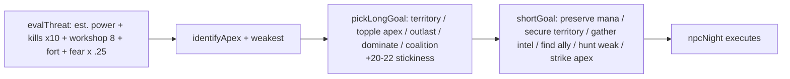

# 08 — NPC AI & Emergent Narrative

The war is designed to play itself: six or seven AI pairs plan, ally, betray and kill each other whether or not the player
acts. The AI is layered (persona → relationships → plan → action), and its notable acts are recorded as facts that become a
story at the end.

## 8.1 Personas (index.html:7069–7105)

| Persona | Axes | Derived from |
|---|---|---|
| `servantPersona` | pride, loyalty, caution, ruthless (tags at 70/70/65/65) | `HX` personality, alignment, traits, class, `sp` |
| `masterPersona` | pride, cunning, ruthless, loyal, caution | archetype sets (`CUNNING_AID`, `RUTHLESS_AID`, `PRIDE_AID`, `LOYAL_AID`) + tactic |

Master **tactics** (per archetype) color everything: defensive, reckless, hunter, cunning, proud, naive, desperate.

## 8.2 Six-axis relationship matrix (7063–7195)

Every ordered pair of actors has `REL_AXES` = **trust, affection, fear, respect, rivalry, grudge**.

| Rule | Value |
|---|---|
| Defaults | 25 / 10 / 0 / 20 / 10 / 0 |
| Seeds | `PAIRV` rivals: rivalry +28, respect +22; Church agents vs Apostle: grudge 55 |
| After a battle | loser: fear +10, respect +8, rivalry +10, grudge +12 |
| Command Seal use (own servant) | fear +10, grudge +3/+8, affection −4 |

**Betrayal score** (`betrayScore` 7181):

```
.12 + (ruth − 40)×.005 + grudge×.006 + rivalry×(final ? .004 : .0015)
    + max(0, 50 − trust)×.0055 + max(0, 30 − aff)×.003
    − trust×.0035 − aff×.003 − respect×.0025 − (loyal − 40)×.004
    + slight×.1 − owe×.08 ± fear (×.003 if target weak, −×.0045 otherwise)
clamped .01–.95
```

## 8.3 Strategic planner (7655–7895)



- **Threat estimate** uses true power only if intel ≥ 35–40; otherwise estimates.
- **Vulnerability** of the weakest: `(100 − hp) + 28 (master hurt) + 20 (SM < 30) + 12 (no seals) − threat × .15`.

| Short goal | Execution in `npcNight` (14390) |
|---|---|
| Preserve mana | rest or hide; NP use ×.25 |
| Secure territory | fort +12–18, workshop +22–34 |
| Gather intel | +25 knowledge of target; if target is you: `knowMe` +25, your Exposure +4 |
| Find ally | NPC–NPC pact, or alliance offer to you (45 %, from day 2) |
| Hunt weak / Strike apex | raid; plan target weighted ×3.5; an NPC ally joins the apex strike |

**Raid pressure:** `(.16 + day × .03) × crisis factor × aggression`; targets weighted by grudge and rivalry; cunning masters
prefer the wounded. **Enemy cooperation** (`npcEnemyCoop` 7598): from day 4, if you have ≥ 2 kills or there is a strong NPC,
35 % two rivals team up (against you this sets a coalition). **NPC class actions** mirror the player's: snipe 30 %, Avenger
mark 40 %, Rider scout 25 %, Caster workshop 60 %, Assassin infiltrate 25 %, Ruler seal 20 %.

## 8.4 Alliances with you

| Step | Rule |
|---|---|
| Acceptance (`allyPick` 10909) | `pc = .28 + .28 (naive/desperate) − .15 (pride ≥ 65) + (trust − 25)×.004 + respect×.003 − grudge×.006 + Bonds/400 + .15 (hp < 50) + .2 (friendly) + .1 (crisis ≥ 2) − 1 (executor) + .2 (democrat) − .1 (via familiar)` |
| Limit | one ally at a time |
| Confiding | ally reveals true name and NP 75 % (30 % cunning/proud/killer/mercenary; 85 % ghosts) |
| Defending you | `ALLY_COME` (defensive/naive .45 … cunning .2) + .1 × owe − .1 × slight |
| Selling you out | ruthless ally, after 2 days, sells your lair with `betrayScore × .42` |
| NPC–NPC betrayal | ruthless (≥ 65) partner betrays an ally under 40 HP with `min(.55, betrayScore × .45)` |
| Final two (`allyIntent` 14836) | base [betray, share, yield]: `ALLY_B` archetypes [.55, .28, .17], `ALLY_Y` [.10, .35, .55], others [.15, .65, .20]; adjusted by betrayScore, Bonds and relationship axes |

## 8.5 Emergent narrative (7211–7563)

| Stage | What it does |
|---|---|
| `recFact` | records up to 120 typed facts per war: `ally_form`, `ally_betray`, `ally_abandon`, `ally_ignore`, `ally_help`, `enemy_coop`, `order_refuse`, `servant_defect`, `servant_protect`, `seal_force`, `duel_clash`, `master_die_stray`, `stray_fight`, `stray_recontract` |
| `narrBeat` | one-line story beats in 5 languages |
| `detectArcs` | groups facts into arcs: betrayal (cause chain + aftermath), masterless, enemy coalition, defiance (seal uses + refusals), devotion |
| `renderNarrative` | title + body cards in the war report ("That Winter's Story") |

**War titles** (`TITLES` 7552), by priority:

1. Betrayal → "The Winter of Broken Oaths"
2. Masterless → "The Night of the Masterless Blade"
3. Enemy coalition → "Enemies Under One Banner"
4. Defiance → "Chronicle of the Unbowed Hero"
5. Devotion → "Vigil of Unyielding Loyalty"
6. Otherwise → "Chronicle of the Winter War"

## 8.6 Known AI defects (details in chapter 14)

- `pickLongGoal` reads `mp.madness` and `mp.loyalty`, which `masterPersona` never sets (it returns `loyal`): two goal terms are
  always zero.
- `detectArcs` looks for a `kill` fact that is never recorded; the in-battle "servant shields you" moment never records
  `servant_protect` (only `loyalIntercept` does).
- Comments in the AI/narrative/planner modules are in Indonesian, unlike the rest of the file (post-2.02 commits).
