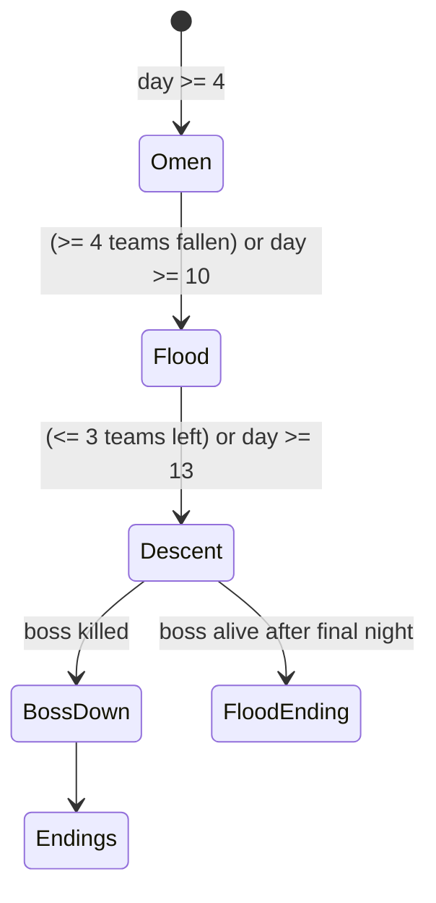
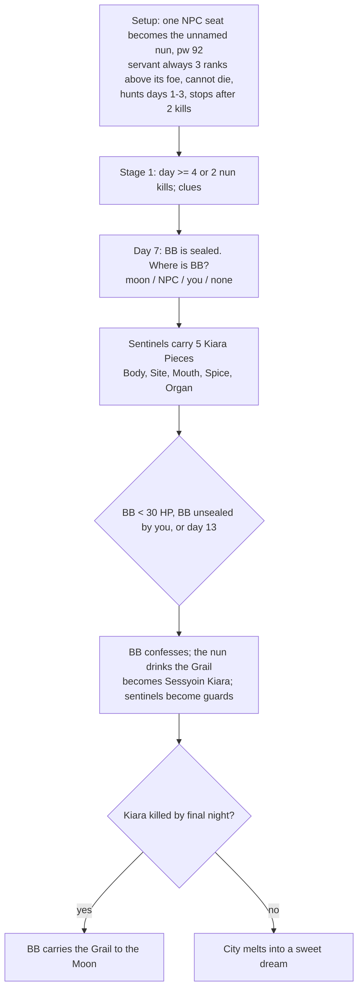
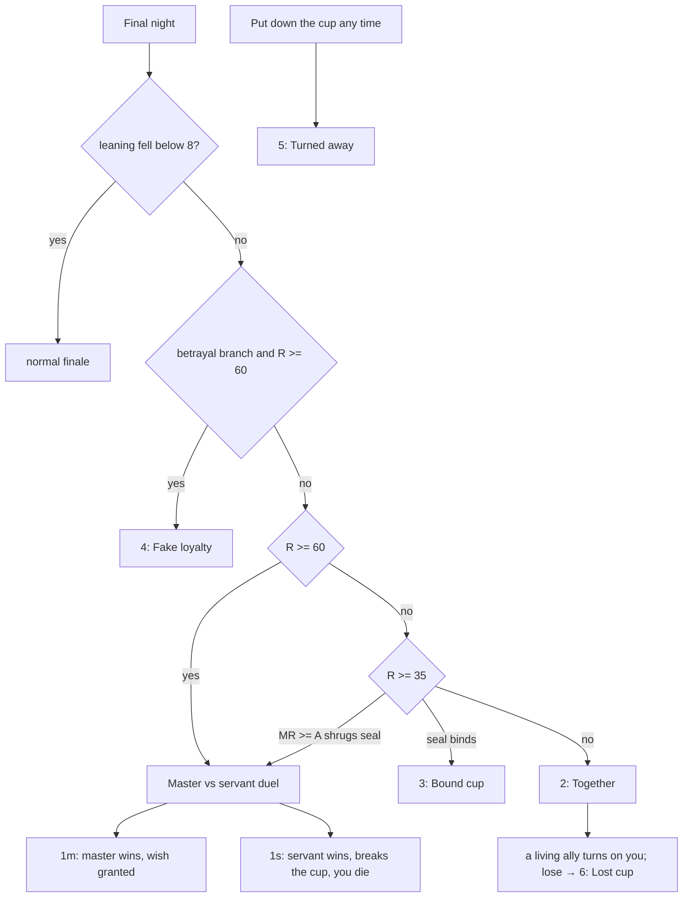

# 09 — Crises & Special Routes

Four systems change the shape of a war: two **late-game crises** that turn the war into a co-op boss scenario, the hidden
**True Wish** finale, and the **Moon route** that gates BB, Meltryllis and Passionlip.

## 9.1 Crisis roll (`CRISIS` index.html:8165, `crisisRoll` 8180, extension 9050)

Rolled once at summon. A crisis war always has a dark Grail.

```
CRISIS = {p: .2, pAv: .25, list: [{id:'black', w:1, wAv:2}, {id:'beast3R', w:1, wAv:1}]}
P(crisis X) = p × weight(X) / total weight
```

| War | Any crisis | Black Grail | Beast III/R |
|---|---|---|---|
| No Avenger | 20 % | 10 % | 10 % |
| Any Avenger in the war | 25 % | ≈ 16.7 % | ≈ 8.3 % |

Each crisis can be set to natural / always / off in the **Scenario** dialog once experienced (chapter 11); the choice is
locked at birth. The comment at 8160 ("20 %, 25 % with an Avenger" for the Black Grail alone) predates the Beast crisis.

## 9.2 Black Grail (`type:'black'`, 8160–8600)



| Stage | What happens |
|---|---|
| 1 Omen | Supervisor notices the Grail filling too fast; 50 % daily omen line (7 variants). You learn the truth at `.08 + Knowledge/800` per day; Ambition servants deny it (persuade: `.4 + Bonds/250`) |
| 2 Flood | Public announcement; each NPC picks a **stance** (break / claim / out); two sites become contaminated zones; **shadows** spawn |
| 3 Descent | Grail appears; the Avenger branch resolves; the **boss** spawns; **culling** begins |

**NPC stances** (`cxStance` 8201): hunter/defensive → break; proud/reckless/desperate → claim; cunning 30 % out else claim;
naive 50 % out else break; NPCs with an Avenger always break.

**Shadows** (8247): 2–3 fallen non-Avenger servants (first the strongest you killed). HP/SM 100, pw 70, no master, cannot be
allied/truced/assassinated. 70 % per night to attack (×3 toward their killer, ×.5 on you while hidden). +10 HP/+15 SM per
night. Each kill grants +1 Command Seal.

**Boss** (8257): priority (1) an Avenger who defected (yours, or an NPC's: reckless/desperate 70 %, others 40 %), (2) an
Avenger who fell, (3) a new Avenger from outside the seven. Stats raised rank by rank until `heroBase` reaches 113.
`CXB = {pw:38, hp2:30, desc:-22, nd:-15, na:5, ad:1.2, np:.3, tgt:113, j:[0,6,14,14], ref:134}`; phase 2 returns at HP 30.
**Design target** (8168): your win rate solo 35 %, with 2 teams 45 %, with 3 teams 55 %. Companions add `j[n]` to the roll.

**Your Avenger at Descent:** Trust ≥ 80 → becomes **the Key** (in-battle `cxKeyAct`: boss HP −60, your servant HP −40/SM −20);
Trust < 40 → defects; between → spend a seal to hold it. Earlier stages offer `cxCall` (hold: Trust +6; ignore: +5 rolls,
Trust −6).

**Culling** (8301): while > 3 teams remain, the weakest are swallowed into shadows. If chosen, resist at
`clamp(.3 + ((Spirit + Mana)/2 − 30)/100, .3, .8)` or spend a seal.

**Crisis night actions:** spread evidence (Exposure +5, NPCs may withdraw), harvest mud (SM +40, next battle +10, Trust −3,
Spirit −4, Exposure +8; every 3rd adds permanent taint), hunt a shadow, go to the Grail (joint fights via `cxPlan`/`cxInvite`),
ambush a team returning from the Grail. NPCs go to the boss with stance-based odds (`cxGoP` 8278).

**Endings** (`cxAfterBoss` 8527):

| Choice | Rule | Result |
|---|---|---|
| Key ending | you are the Key; trust ≥ 90 stays, 75–89 dawn farewell, ≤ 74 vanishes | `keyRemain`/`keyStay`/`keyGone` |
| Break with NP | half NP cost; not enough SM → servant fades | `brokeCup` |
| Break with a seal | 1 seal | `brokeCup` |
| Seal the Grail | success from `(Mana + Knowledge)/2`: ≥ 70 → 100 %, < 40 → 0 %, linear between; fail: Spirit −10, forced break | `cupSealed` |
| Claim anyway | wish, then Spirit −25, Health −12, Wealth −15, Bonds −10 | `cxClaim` |
| NPC claims | city centre erased: Spirit −15, Health −12, Wealth −20, Bonds −6 | `cxNpcClaim` |
| Flood | nobody kills the boss: Spirit −30, Health −25, Wealth −30, Bonds −10 (−15 Health more if Exposure ≥ 60 or Health < 20) | `cxFlood` |

If an NPC killed the boss you may take the Grail by force; the strongest opposing team blocks you (`cxMatch` levels its HP/SM
to yours).

## 9.3 Beast III/R (`beast3R`, BX 8599–9073; plan `dev/BX_PLAN.md`)

A hook layer over the Black Grail machinery. Units: sentinels, BB from the Moon, and the boss Kiara (class `beast`,
C/B/EX/EX/A).



| Mechanic | Rule |
|---|---|
| Nun intel | intel ≥ 70 reveals "Kiara Kishouin"; she gets a fake elimination notice at day 7 |
| Suspicion per NPC (`bxSusp` 8735) | `pw/2` + tactic + archetype (±15) + alignment + knowledge of nun/4 + 20 (Kama +30) |
| Subjugation order | targets BB's holder; breaking BB → +1 seal |
| Sentinels at night | 70 % pressure BB (10–15 HP, +2 per extra sentinel), else 30 % (70 % in no-BB life) hunt others; NPCs with suspicion ≥ 70 hunt sentinels 25 % |
| Kiara Pieces | each sentinel raises one Kiara stat a rank; Organ +12 HP/night; killing a sentinel takes its piece (+1 seal) |
| Absorption | servants falling with no free piece: +2 % Kiara HP each |
| No-BB life | descent on day 11 (earlier if ≤ 2 teams left) |
| Rewritten karma | confession/unseal paths multiply Kiara HP by 0.85 |

**Kiara's durability** (`bxMult` 8635): damage taken is divided by

```
(1 + kpT[pieces left] + .05 × days sealed + .02 × absorbed) × (.85 karma) × (2.8 if no player in the fight) × 1.3
kpT = [0, .5, 1.25, 2.25, 3.5, 5]
```

Phase 2 at HP 50; +15 HP/+20 SM per day; +15 HP per NP; roll modifier −56 vs you, −41 vs NPCs (−10 if BB is your ally, −5.4
per freed Alter Ego). Battle extras: Spirit check at start; 15 %/round charm if your servant's MANA ≤ A; guards act 30 %/round
(cover 60 / chip 20 / attack 20); area NPs hit guards by scope (anti-world/country 100 %, anti-fortress 95 %, anti-army 85 %,
anti-formation 75 %); freed Meltryllis/Passionlip assist.

**Measured balance (BX_PLAN, solo Kiara fight, pieces left 0/1/2/3):** confession path 72/47/16/2 % vs targets 73/41/17/1;
forced day-13 path 47/12/2/0 vs targets 35/13/3/0.

**Code vs plan:** karma ×0.85 (plan 0.7); NPC roll −41 (plan −25); NPC-only HP ×2.8 (plan ×2); global ×1.3 not in the plan.
**Unfinished:** `bxRep()` returns `null` (no server stats for Beast lives); `bxPostDay` is empty; player area NPs don't sweep
guards in the player fight; companion NPCs don't target guards.

## 9.4 True Wish route — "True wish within one's nature" (`kg`, 11241–12019)

A hidden alternate Grail finale (patch 2.02). Internal name "The One Who Did Not Sheathe the Sword".

**Entry** (`kgCan` 11680): one leaning ≥ 8 (Vengeance, Justice, Cruelty, Taboo or Root), servant alive, no crisis.

| Leaning | Wish |
|---|---|
| Vengeance | "Repay everything that trampled me" |
| Justice | "A justice no one can defy" |
| Cruelty | "A world without the weak" |
| Taboo | "Open the door beyond to this side" |
| Root | "Use this whole city as a stepping stone to the Root" |

**Servant resolve R** (`kgRes0` 11687): base 40; Honor +10, Compassion +15 × (1 + .25 × stage), Freedom +5, Loyalty −5,
Ambition −10; Good +15, Evil −15; ±10 per liked/disliked tactic; trust term (≥ 80 −10 … < 40 +10) × trait factor × law factor
(Lawful 1.5, Chaotic .5); bond stage +0/5/10/15. Later changes × 1/1.25/1.5/2 by stage.

**Four days and nights** of events (traces; someone close pays the price; another hand; an ordinary day; nightly question,
promise, memory), each nudging R and offering "Put down the cup".



Seven endings (① m/s, ② together, ③ bound, ④ fake loyalty, ⑤ turned away, ⑥ lost cup) and the meta-achievement `kg7`;
23 route achievements; 220 epilogue events, 150 afterwords and 945 servant lines (`kg_apply.py`). Ending ③ runs its own
timeline (14 days → 12 months → 9 years). Tests: `dev/kg_test.js` forces 16 scenarios, one per ending path.

## 9.5 Moon route (`MOON_GATED` 17058, `moonDo` 10750)

| Path | Rule |
|---|---|
| BB hijacks your summon | full moon (1 in 8) **and** no catalyst: 2.5 %, 5 % with the Moon Vow; with `_bbsend`, 1 in 3 hijacks bring Meltryllis/Passionlip instead |
| 8th seat | 12 % extra special seat; if you have BB, half are an Alter Ego; on a full moon BB is a candidate; an NPC BB brings an Ego 50 % |
| Ego joins you | with BB, 4 % each morning on days 2–8 an Ego joins as a stray team (not during Beast III/R) |
| Moon Cancer action | "Rewrite records": Exposure −20, +25 intel, 3-day cooldown |
| Unlock | defeating Kiara sets `_bbmoon` → Moon Vow (doubles hijack chance) |
