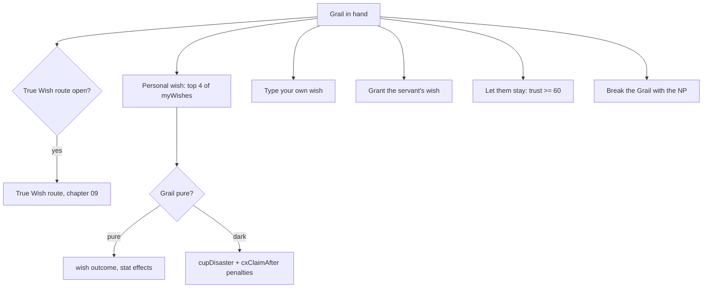

# 10 — Endings & Epilogue

## 10.1 War outcome keys (index.html:6829)

| Key | Meaning |
|---|---|
| `victor` | You won the Grail |
| `shared` | You shared the Grail with your last ally |
| `lost` | Your servant fell / you lost the final |
| `survived` | You lived through it without winning |
| `withdrew` | You left the war (`settleRest` simulates the rest) |
| `refused` | You handed the seals to the Church before summoning |
| `dead` | You died during the war |
| `none` | No war (died before war age) |
| `collapsed` | Labelled in the UI but **never set** by the engine (see chapter 14) |

## 10.2 Finale — wishing on the Grail (`finale`, 14877)

| Option | Rule |
|---|---|
| Personal wishes | top 4 of `myWishes` by score: revive a dead parent, find your birth parent, revenge / restore your house, reach the Root, justice, family safety, undo a betrayal, see outside the world, a mundane life; each has a pure and a dark outcome |
| Typed wish | free text recorded in the life record |
| Servant's wish (`grantHero`) | `LOVE_WISH` servants (Suzuka, Frankenstein, Tamamo, Passionlip, Serenity, Melusine) at stage 3: "already fulfilled", they stay; Solomon + pure Grail → becomes human (stays at trust ≥ 60); Iskandar → gets a body at trust ≥ 60; dark Grail at trust ≥ 60 → the servant stops you |
| Let them stay | Trust ≥ `STAY_NEED` (60); with a dark Grail → `stayDark` |
| Break the Grail | costs SM; if short, the servant fades or you spend a seal; Solomon uses Ars Nova |
| `allyFinal` | last two are allies: fight / share (an ally with betray intent ambushes) / yield |

**Grail purity:** without a crisis the Grail is always pure (`cupPure = !crisis`, 7006); with a crisis it is always dark.

**Ending FX keys** (`endFxOf` 14979): `wish`, `shared`, `heroWish`, `loveWish`, `stay`, `breakFade`, `breakStay`, `withdrew`,
`lost`, `survived`, crisis keys (`seal`, `keyRemain`, `keyStay`, `keyGone`, `flood`, `claim`, `nclaim`, `nbreak`, `cbreak`),
Beast keys (`bxm_*`, `bxdream`). Each maps to ending music (`END_SND`) and a full-screen ending scene (chapter 12).

## 10.3 Epilogue (`startEpilogue` 14994 – ~17000)

| Element | Rule |
|---|---|
| Opening | 2 `EPI_START` scenes ("Spring", "The road after") |
| Body | 8–10 picks from `EPI_POOL` (238 entries; 13–15 when the True Wish flag `kg6` is set), at most 2 `ARC` chains (15551) |
| Pacing | years jump via `passYears` (15023); each step waits `spy × 1.3 × ep2Gap` (`ep2Gap` .5/.7/1 by phase); mortality is rolled every year |
| Relationship scenes | 60 % per step (`relEpiTry`), ~37 events (`EP_REL` 16653) |
| Final beat | `EPI_END` "The Grail fills again" at `warYear + 58` (text says 60 years) |

**Epilogue timelines** (from `dev/epi2.js`, `dev/epi3.js`):

| Case | Phases |
|---|---|
| Servant stayed with you | A: 14 spring days → B: first year by month → C: 10 years by year → D: regular system |
| Servant left (away / won / lost) | A and B only, plus leaning-specific events |

**Relationship epilogue content:**

| Track | Scenes |
|---|---|
| Love | morning, anniversary, the night, wedding (needs legal papers), child (birth if female side ≤ 45 and opposite sex, else adoption), first cry, the child's heroic blood, crest passes to the child |
| Friendship | drink, old battlefield, job, family, godparent, crisis (Health +12), oath day |
| Departed servant | dream, keepsake, anniversary, moving on |
| Old age | 22 % of lives: the servant ages from ~66 + 0–5 (`OLD_C`); last autumn → last place → farewell (5 lines per track) → grave, keepsake, empty seat, dream |

## 10.4 Death

- If the servant stayed and lives with you: `lastNight()` (16759).
- Otherwise `relMeet()` (16730): the servant appears at the door if they died of old age or left at relationship stage ≥ 2.
- `die()` (6803): log the death, offer **last words** (a free-text box, addressed to the servant if there was one),
  `deadSettle()` settles open war pairs, `record()` writes the history entry.

## 10.5 War report & share (UI 20280–20380)

| Element | Content |
|---|---|
| `warReport` | verdict, your pair, battle stats, Command Seal timeline, pair table with "facts you never knew" markers, narrative arcs ("That Winter's Story"), day-by-day log |
| `showEnding` | record card + report + life block + ghost-team and scenario notes + capture/copy buttons |
| `shareText` | localized one-paragraph summary to copy |
| Image capture | html2canvas (lazy-loaded): choose record / war / timeline; PNG download on desktop, native share on phones |
