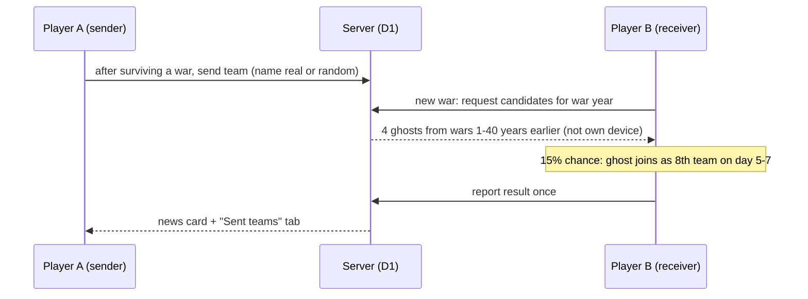

# 11 — Meta-progression

Lives are short and random; what persists across lives is **knowledge and collection**, not power. There is no stat carry-over.
The only mechanical carry-overs are the bond summon (a better chance at a known servant), scenario unlocks, and the Moon Vow.

## 11.1 Codex (`cupnight.codex.v1`; `dexLoad` index.html:20162, `renderDex` 20200, `showDexInfo` 20235)

| Per servant | Tracked |
|---|---|
| State | u (unknown) → s (seen in results only) → m (met) → c (contracted) |
| Record | contracts, Grails won, max trust, kills, met, beaten, first meeting (year/city) |
| Lore | story fragments heard, relic held |
| Bond | highest relationship stage per track (love: liking/longing/lover; friend: comrade/best friend/soulmate) |
| Global | server stats when ≥ 30 lives exist (`GS_MIN`) |

Progress bars: contracted, met, bond stage 3 — each over 135. Special classes stay "???" until opened; an optional spoiler
toggle shows all names.

## 11.2 Achievements (`ACH` 5390, `achCheck` 5492)

**219 in the client:**

| Group | Count |
|---|---|
| End of the War | 50 |
| My Servant and I | 18 |
| Hidden | 12 |
| Life | 8 |
| Battle | 7 |
| Log | 5 |
| Learned Arts (generated: per line per tier; Secret Art tiers hidden) | 75 |
| Mystic Eyes (generated: awaken + proficient per type; 4 types hidden) | 32 |
| Extras (selfpath, threeways, bodyart, familyname, untaught, baptnight, beyondarc, arts10, eyes5, h_jewel, h_rainbow, h_word) | 12 |

About 26 are hidden. Seven are **meta** (cross-life, judged from the codex): `seven`, `lives10`, `halfdex`, `rel10`, `kg7`,
`arts10`, `eyes5`. Predicates are evaluated every tick and after every choice; ids are permanent. Toast with sound `u_ach`;
"NEW" markers from `cupnight.achSeen.v1`.

Examples: `century` (live to 100), `kids2`, `putdown` (give up magecraft), `novel` (publish a book about that winter),
`nextwar` (hear of the next war), `refused`, `selfpath` (found your own family line), `h_rainbow` (a Rainbow eye awakens).

> **Server drift:** `src/known.js` accepts only 194 achievement ids. Achievements added after 11-22 (new eyes such as
> Prolongation/Death Perception and the four new arts) are silently dropped from global stats. See chapter 14.

## 11.3 Past lives (`renderPast` 20097)

Last 40 lives (`HIST_MAX`) plus a lifetime counter. Filters: Grail / killed in battle / servant lost / other / not a master.
Each entry keeps notes from the reflection prompts and last words.

## 11.4 Bond summon (`bondChance` 18813, `bondRender` 18825)

Pick a servant contracted in a past life before birth.

| Condition | Chance at summon |
|---|---|
| You won a Grail with them | 100 % |
| Otherwise | `min(.6, .1 + last trust × .005)` |
| Alter Ego freed in Beast III/R (`_free_<id>`) | 30 % |

Lives started this way are excluded from global stats. UI: class tabs, search, sort, "sure only" filter.

## 11.5 Scenario unlocks (`scnOpen` 18948, `scnUnlock` 18941)

| Unlock | Condition | Effect |
|---|---|---|
| Black Grail scenario | a Black Grail life reached stage ≥ 2 | set natural / always / off |
| Beast scenario | a Beast life reached stage ≥ 3 | same |
| Moon Vow (`_bbmoon`) | defeat Kiara | BB hijack 2.5 % → 5 % |
| `_bbsend` | BB sent the Grail to the Moon | hijack may bring an Alter Ego (1 in 3) |

## 11.6 Ghost teams — asynchronous multiplayer (`gh*` 19938–20067; server `/api/ghost*`)

| Rule | Value |
|---|---|
| Eligible endings to send | victor / shared / survived / withdrew |
| Ghost knowledge | carries knowledge of names, NPs, past fights and allies (`gEdge`: +5 name / +3 NP / +2 / −4) |
| Ghost stats on join | HP 60–75, pw 58–88 |
| Caps | 30 sent per device; name 1–20 chars + KO/EN/JA profanity list; hidden after 3 distinct reports |
| Opt-out | `cupnight.noghost.v1` |

## 11.7 Global statistics

`gsSend` posts each life result (anonymous, opt-out `cupnight.nostats.v1`); `gsLoad` refreshes every 30 min. Public dashboard
`public/stats.html`: class, servant, ending tables and a Black Grail section with date-range chips. Shown in the codex as
per-servant win rates and contract counts.
