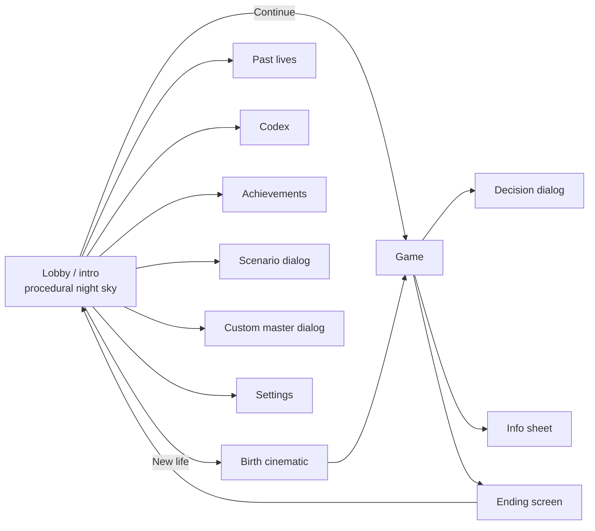

# 12 — UI, UX & Presentation

The game is presented as a **scrolling log** with decision dialogs, framed by procedural art, full-screen canvas FX for big
moments, and a layered soundtrack. Dark theme only (`color-scheme: dark`).

## 12.1 Screen map (HTML index.html:2066–2222)

| Screen | Contents |
|---|---|
| Lobby (`#lobbyBg`, `#intro`) | procedural lobby (17143): 4 night skies; city lights = lives lived, servant stars = codex count; Continue ("name, age"), past lives, codex, achievements, ghost news, sync; sex picker; bond-summon panel |
| Birth (`#birth`, `Birth.run` 18631) | globe and skyline zoom to your city → name form (re-roll, keep, skip next time) → origin scene (tree / church / common / orphan / exorcist) with magic-circuit traces and a circuit-grade jingle |
| Game (`#game`) | tabs: log feed, status; seven-team list with crisis banner (`cxBanner` 19147: icon, name, 3 phase pips); war narrative; learned arts; year goal; family; speed and auto controls; year progress bar |
| Decision (`#dlg`, `showDecision` 19697) | title, body, choice buttons with stat chips and requirement hints; `manual` dialogs disable auto |
| Info (`#info`) | servant card (stats, NP, skills, traits), 6-axis relationship view, planner/risk view |
| Ending (`#ending`) | record card, war report, share/capture |
| Dialogs | settings, custom master, scenarios, language, patch notes (`PATCH` 18846: v1.00 2026-10-22 → v2.02 2026-11-22), help |

## 12.2 Feedback channels

| Moment | Visual | Audio |
|---|---|---|
| Stat change | delta chips on the log line | — |
| Check | ✓/✗ line with stat names | — |
| Summon | `summonFx` (19351): circle, flame tongues, class theme | class summon sound |
| NP clash | `clashFx` (20545) | `j_pierce_me` / `_en` / `j_cancel` |
| Command Seal | `sealFx` | `j_seal` |
| Grail descent / boss | `descentFx`, `bossFx`, `bossP2Fx`, `defectFx` | `j_descent`, boss BGM |
| Beast III/R | `bxSealFx`, `bxDescFx`, `bxKpFx`, `bxFreeFx`, `bxConfFx`, `bxOrderFx` | `bxseal`, `bxdesc`, `kiara` |
| True Wish | `kgInFx`, `kgBackFx`, `kgDayFx`, `kgFullFx`, `kgDuelFx`, `kgMrFx`, `kgAllyFx` | `kg*` |
| Ending | `endFx` → crisis or normal end show (21617–) | `END_SND` map |
| Achievement | toast | `u_ach` |

All full-screen FX go through `xfxOpen`: a canvas that runs in real time regardless of game speed, pauses the sim (`HOLD`),
and can be clicked to skip. Each FX family can be turned off in settings.

## 12.3 Art assets

| Asset | Count | Status |
|---|---|---|
| Portraits (`assets/portraits/*.webp`) | 136 + `faces72.webp` atlas (135 cells) | used |
| Lobby skies | 4 webp | used |
| Procedural art | city skylines, globe, landmarks, sigils, origin scenes (17767–18640) | used |
| Sprites (`assets/sprites/`) | 343 files, 81 MB: 135 portraits, 43 servants with base/attack/NP sheets, 65 master sprites | **not referenced by the game** — an unfinished pixel-art battle feature |

## 12.4 Audio (`SND_M` 22508, `sndScene` 22580)

145 MP3s with loop points.

| Prefix | Use | Count |
|---|---|---|
| `a_` | ambience | 3 |
| `b_` | birth, circuit grade, origin | 10 |
| `f_` | combat hits (class weapon sets `SND_WPN`) | 12 |
| `j_` | jingles | 75 |
| `m_` | magic | 4 |
| `u_` | UI | 10 |
| `end_*` | ending music | 8 |
| Scene BGM | `lobby1-5`, `life`, `day`, `night`, `battle`, `final`, `boss`, `black`, `kiara`, `bbfight`, `emiyafight`, `bxseal`, `bxdesc`, `kg*`, `epi` | — |

Web Audio with separate BGM and SFX buses; 1.2 s crossfades; BGM ducks to 30 % under jingles; life SFX muted at 8×; only one
tab plays sound (BroadcastChannel).

## 12.5 Localization (`tr` 17485)

The engine and UI are written in Korean; displayed DOM text is translated **live** (`trNode` + MutationObserver):

1. exact dictionary match
2. quote/paren normalization
3. sentence splitting
4. template matching (`_trTpl`, `{n}` slots and Korean particle variants; candidates from a rare-bigram index; step cap
   300k, depth 4, memo caches)

Languages: ko (source), en, ja, zhs, zht (Chinese translated directly from Korean using official FGO names; missing lines fall
back to English). Only the chosen pack is loaded (1921).

## 12.6 Controls & accessibility

| Input | Action |
|---|---|
| Space | pause / resume |
| 1–4 | speed 1× / 2× / 4× / 8× (outside dialogs) |
| A | auto-play |
| M | sound |
| 1–9 | choose option (in dialogs) |
| 0 | fold |
| Esc | close |

Dialogs use `role` / `aria-modal`. FX intentionally **ignore `prefers-reduced-motion`** (20542); only per-type off switches
exist (birth FX, NP-clash FX, seal FX, all FX).

## 12.7 Platform

PWA (`manifest.webmanifest`, standalone); service worker network-first cache (`cupnight-v2`); GoatCounter page views and
events (`born`, `continue`, `end-<key>`, `servant-<id>`).
