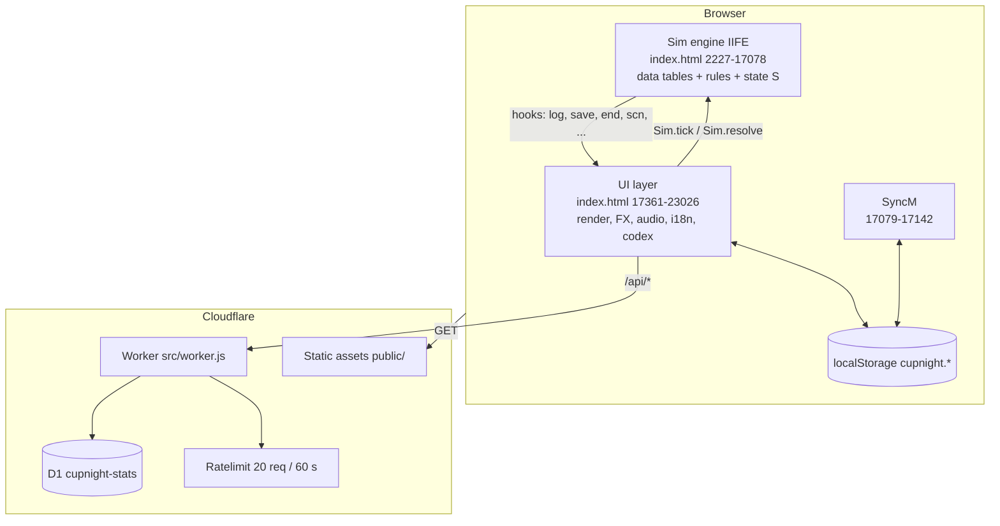
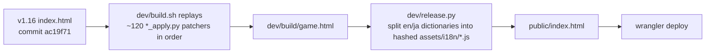

# 13 — Technical Architecture

## 13.1 Runtime layout

- **Engine/UI split:** `Sim` is a single IIFE returning its API at the end of the script (~17070): `newLife`, `start`, `tick`,
  `resolve`, `autoChoice`, `setFocus`, `snapshot`, `load`, `record`, `yearProgress`, data tables (`ACH`, `H`, `CLS`) and the
  live state `S`, plus a hook registry (`setHooks` 5495). `newLife` is monkey-patched just before the return to inject the Moon
  flags. The UI subscribes to hooks (`log` dispatches FX at 22659, `save` at 22663, `end` at 22671).
- **State:** one object `S` (life) with `S.war` (war, via `W()`); the full state is JSON-serialized on save.
- **Determinism:** seeded `mulberry32`; side rolls use hashed sub-streams so adding a roll does not shift the main sequence.

## 13.2 Persistence

| Key | Purpose |
|---|---|
| `save.v1` | current life snapshot (autosave) |
| `history.v1`, `count.v1`, `codex.v1`, `achSeen.v1` | past lives and collection |
| `bond.v1`, `bond.recent.v1`, `bond.open.v1` | bond summon |
| `scn`, `scnUnlock`, `scnSeen` | scenarios |
| `custom.v1` | custom master |
| `sex.v1`, `nameFix.v1`, `lang`, `patch.v1`, `tips` | preferences |
| `snd.v1`, `nofx`, `noclashfx`, `nosealfx`, `nopickup.v1`, `nostats.v1`, `noghost.v1` | settings |
| `dev.v1` | random device id |
| `gstats.v1`, `ghsent.v1`, `ghnews.v1`, `ghquiet.v1` | stats cache, ghost teams |
| `sync.v1`, `syncalt.v1`, `synckick.v1`, `savem.v1`, `play.v1` | device sync and play lock |

**Migration:** the old GitHub Pages root (`index.html`, `sw.js`) gzips all `cupnight.*` keys into `#mig=` and redirects; the
new site imports only keys not already present (`index.html:5–12`). **No file export/import** — device sync replaces it.

**Device sync** (`/api/sync/*`, `SyncM`): up to 5 devices; 8-character single-use join code valid 10 minutes; only SHA-256
hashes of secrets stored; data is an opaque gzip blob ≤ 1.4 MB; optimistic version check (409 + server copy on conflict);
three-way merge client-side; a play-lock token prevents two devices playing the same life; expires after 180 days unused.

## 13.3 Server API (`src/worker.js`, D1 `cupnight-stats`)

| Route | Rules |
|---|---|
| `GET /api/health` | no rate limit |
| `POST /api/life` | body ≤ 8 KB; ending, hero (+ class match), cup, lang, achievements, city, origin all allowlisted (`src/known.js`); 150 lives/device/day |
| `POST /api/life/fix` | one-off repair for 17 heroes missing from the allowlist before 2026-11-02 |
| `GET /api/stats` | snapshot rebuilt every 10 min under a single-writer lock; 1-min isolate cache; trigger-maintained counters; `?since/until` hourly |
| `POST/GET /api/ghost` + `/shown`, `/withdraw`, `/report`, `/result`, `/news`, `/mine` | ghost teams (chapter 11); results accepted only from devices that saw the ghost |
| `/api/sync/{new,code,join,pull,push,leave,devs,kick,name}` | device sync |

Rate limit: 20 requests / 60 s per `kind:IP`. Privacy: no names, free text or IPs stored for stats. **Anti-cheat:** results are
trusted from the client; only enums, ranges, sizes and rates are validated.

`src/known.js` is generated by `tools/known.js` (headless Playwright reading game data): 135 heroes, 194 achievements,
7 origins, 29 cities.

## 13.4 Build & release pipeline

- **Patchers** are idempotent: each checks a marker, and `rp()` asserts the exact match count of every replacement. Many carry
  their own translation tables.
- **Recovery:** `dev/recovery/` holds servant data rebuilt after a container loss on 11-12 (`dev/BX_PLAN.md` notes the original
  Beast sources were lost and re-implemented).

## 13.5 Testing

| Tool | Purpose |
|---|---|
| `dev/sim.js` | headless: runs only `<script id="sim">` in `node:vm` with no-op hooks; N lives with `{hero, crisis, pat}` options |
| `dev/bxsim.js`, `dev/bxfight.js` | Beast III/R phase summary and Kiara win-rate tables |
| `dev/moontest.js` | Moon-route frequencies |
| `dev/kg_test.js`, `kg_tr_test.js`, `kg_ui_test.js` | True Wish: 16 forced scenarios, translations, UI |
| `dev/*_test.js` | AI relationships, arts, eyes, narrative, planner, custom master, share, … |
| `dev/uicheck.js`, `uirun.js`, `ep2test.js` | Playwright browser checks (translation spot-checks, epilogue) |
| `dev/mktest.py` + `test_panel.js` | self-contained test build with damage multipliers, forced hero/crisis, speed |

There is no CI; tests are run by hand. Balance targets live in code comments (e.g. `CXB` 8168) and in `dev/BX_PLAN.md`.

## 13.6 Technical risks

- A 5 MB single HTML file with lines up to 750 KB (`RLU`) makes diffs, reviews and editor tooling painful.
- Live DOM translation through MutationObserver is CPU-heavy on low-end phones (capped by step limits).
- The patch-replay build means `public/index.html` is a build artifact while also being committed; the post-2.02 commits
  were added to `build.sh`, but `src/known.js` was not regenerated (achievement drift).
- Client-trusted results make global stats spoofable; acceptable for a fan project, but worth stating.
